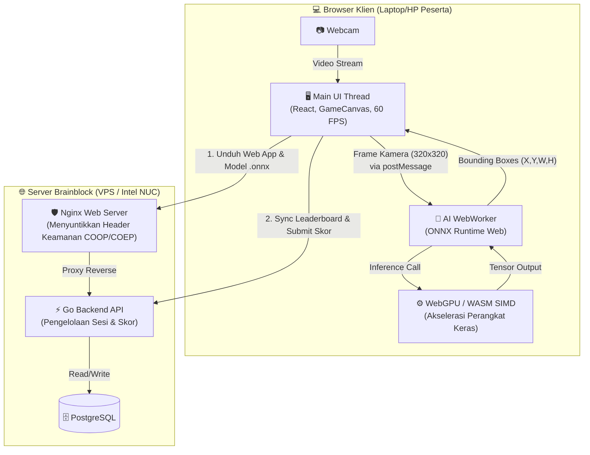
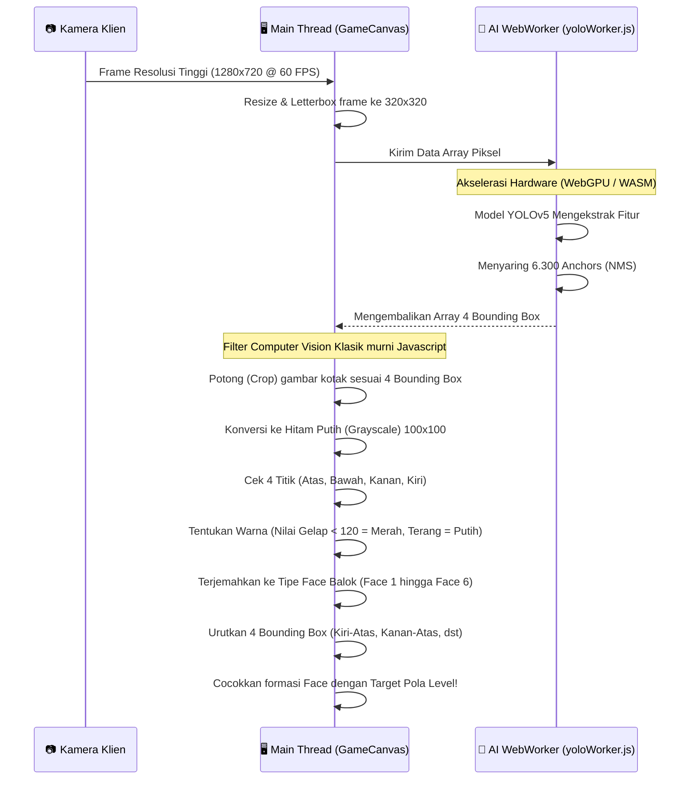

# Arsitektur Teknologi Brainblock (Web-Native AI)

Dokumen ini menjelaskan arsitektur teknologi dari sistem deteksi AI Brainblock versi Web (berbasis browser), yang dirancang untuk skalabilitas turnamen publik (Client-Side Inference).

## 1. Konsep Utama: Serverless Computer Vision
Untuk mendukung ribuan peserta secara serentak tanpa membebani biaya server, sistem **tidak menggunakan server Python terpusat (local_ai.py)**. Seluruh beban komputasi Computer Vision (YOLOv5 dan Color Thresholding) ditransfer ke *browser* masing-masing pemain.
- Server Golang hanya bertindak sebagai pengelola sesi, skor, dan penyedia *CORS headers*.
- *Client* (React/Vite) mengunduh model statis `best_320.onnx` sekali pada awal muat, kemudian melakukan *Inference* murni dari komputer lokal pemain.

## 2. Model AI (YOLOv5 ONNX)
- **Model:** YOLOv5 *Custom* yang diekspor menggunakan skrip `export_320.sh`.
- **Resolusi:** 320x320 piksel (diturunkan dari 640x640). Ini mengurangi jumlah kalkulasi matriks dari 25.200 jangkar (*anchors*) menjadi hanya 6.300 jangkar, menghasilkan lonjakan performa 4x lipat.
- **Eksekusi:** Menggunakan `onnxruntime-web`. Dipercepat menggunakan **WebGPU** (akses langsung ke VGA) atau **WASM SIMD** (Multi-threading CPU).

## 3. Alur Deteksi (Pipeline)
Untuk memastikan detik *timer* permainan tidak macet (*lag*) saat AI sedang mendeteksi balok, pemrosesan dipisah menggunakan *WebWorker*.

1. **Camera Feed:** `CameraStream.jsx` menangkap video dan merendernya di UI.
2. **WebWorker Offloading:** `GameCanvas.jsx` menyalin frame ke kanvas rahasia 320x320 dan mengirim *ImageData* ke `yoloWorker.js` untuk menghindari pembekuan UI (UI lag).
3. **Inference:** Pekerja AI (WebWorker) memproses tensor `[1, 3, 320, 320]` dan mengembalikan kotak pembatas (*Bounding Boxes*) dari balok-balok yang terdeteksi.
4. **Color Thresholding (Klasifikasi Face):** Modul utama `GameCanvas.jsx` memotong setiap kotak balok yang terdeteksi, mengubahnya menjadi *Grayscale*, dan melakukan *sampling* kecerahan (<120 merah, >120 putih) pada 4 titik tepi (Atas, Kanan, Bawah, Kiri) untuk menentukan *Face* balok (1 hingga 6). *(Algoritma ini menggantikan pustaka OpenCV di sisi klien).*
5. **Pattern Matching:** `GameCanvas.jsx` mengurutkan posisi keempat balok (Top-Left, Bottom-Left, Top-Right, Bottom-Right) dan mencocokkannya dengan target susunan level.

## 5. Stabilitas Deteksi (Post-Processing)
Karena sistem memproses video secara *real-time*, rentan terjadi getaran (*jitter*) visual. Sistem memitigasinya dengan teknik berikut:
- **NMS (Non-Maximum Suppression):** Ambang batas IOU diatur sangat ketat (`0.30`) agar AI secara otomatis membunuh kotak-kotak ganda yang saling tumpuk (*Double-Double Bounding Boxes*) jika terdeteksi dari sudut yang sedikit berbeda.
- **Strict Confidence Threshold:** Model hanya akan menggambar *Bounding Box* jika keyakinannya di atas `0.65` (65%), demi mencegah benda asing (jari, pinggiran laptop, pantulan meja) dianggap sebagai balok.
- **Color Sampling Precision:** Titik pengambilan sampel warna (merah/putih) diposisikan secara strategis di `35%` dan `65%` dari lebar balok (bukan di ujung tepi). Ini membuat sistem kebal terhadap *bounding box* YOLO yang meleset akibat menangkap bayangan (*shadows*) di sekitar pinggiran balok.
- **Temporal Smoothing (Jitter Tolerance):** `GameCanvas.jsx` menggunakan penyangga (*Buffer*) memori sebanyak 7 bingkai (*frames*). Sistem akan menoleransi hingga 3 *frame* yang cacat/gagal deteksi, memastikan permainan tidak akan secara tiba-tiba me-reset progres keberhasilan pola hanya karena satu kedipan kamera.

## 6. Konfigurasi Keamanan (COOP & COEP)
Agar Multi-threading CPU (melalui WASM `SharedArrayBuffer`) diizinkan oleh sistem keamanan *browser* modern, aplikasi menyuntikkan *header* isolasi ketat pada Nginx:
- `Cross-Origin-Opener-Policy: same-origin`
- `Cross-Origin-Embedder-Policy: require-corp`
- Server Go juga mengirim `Cross-Origin-Resource-Policy: cross-origin`.

*(Catatan: Segala resource eksternal pihak ketiga seperti script CDN tanpa CORS tidak dapat dimuat saat header pelindung WebAssembly ini aktif).*
